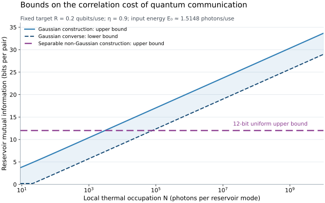

# Quantum Thermal Correlation Cost

Two locally thermal reservoir modes feed a fixed lossy quantum interface. **How much correlation between the reservoirs is needed to preserve quantum communication as their temperature increases without bound?**

At fixed transmissivity and fixed signal input energy, the answer depends on the structure of the reservoir correlations. For a fixed positive rate in the range established here,

```math
C_{\mathrm{all}}(N)=\Theta(1),
\qquad
C_{\mathrm G}(N)=\Theta(\log N),
\qquad N\to\infty.
```

Here $`N`$ is the mean photon occupation of each exact thermal marginal, and the cost is the mutual information between the two reservoir modes. The constant upper bound is attained by a **separable non-Gaussian reservoir**. The Gaussian lower bound permits entangled Gaussian reservoirs and arbitrary signal encoders and decoders. See the [operational model and complete cost theorem](science/model.md).

## An explicit operating point

The construction uses a balanced reservoir mixer and a signal attenuator of transmissivity $`\eta=0.9`$. Each channel use receives a fresh independent reservoir pair. The preparation label and reservoir outputs are unavailable to the sender and receiver.

| Quantity | Bound |
|---|---:|
| Signal energy for every encoded logical state | $`E_0=2\pi/3-1/(4\pi)-1/2\lt1.514818`$ photons per use |
| Unassisted quantum communication rate | More than $`0.24259`$ qubits per use |
| Reservoir mutual information | At most $`12`$ bits per pair |
| Local thermal occupation | Every $`N\gt0`$ |
| Independent thermal reservoir benchmark | Entanglement breaking for $`N\ge9`$ |

A finite shared label correlates small residue cells of the reservoirs' coherent amplitudes. Their difference becomes a lattice displacement plus a bounded remainder. A normalizable finite-energy encoding and coherent modular decoder transfer the large lattice displacement to a discarded subsystem. The decoded qubit channel retains positive coherent information uniformly in $`N`$.

For any fixed target $`0\lt R\lt R_*`$, where $`R_*=0.2425945238\ldots`$ is defined exactly in the [rate proof](science/achievable-rate.md), the same-energy cost bounds for $`N\ge9`$ are

```math
R\le C_{\mathrm{all}}(N)
\le C_{\mathrm{sep}}(N)\le12,
```

```math
\max\{R,\,2g(N)-g(2N)-g(9)\}
\le C_{\mathrm G}(N)
\le2g(N)-g(2N),
```

with $`g(x)=(x+1)\log_2(x+1)-x\log_2x`$ and $`g(0)=0`$. These are matching asymptotic orders; the numerical constants are explicit sufficient bounds.



The blue curves bracket the Gaussian cost at target rate $`R=0.2`$. The horizontal line is the feasible 12-bit upper bound from the separable non-Gaussian construction. The figure plots analytical bounds on the optimized costs. Its [generator and numerical data](verification/README.md#how-to-read-the-figure) are included.

## Read the science

The [scientific overview](science/README.md) connects the construction, converse bounds, and physical interpretation.

| Question | Account |
|---|---|
| What is fixed, what is charged, and what is optimized? | [Model and main theorem](science/model.md) |
| How can a finite label preserve exact thermal marginals? | [Reservoir construction](science/bath-construction.md) |
| How can finite-energy packets tolerate arbitrary lattice shifts? | [Modular subsystem code](science/modular-code.md) |
| Where does the positive unassisted rate come from? | [Decoded channel and rate](science/achievable-rate.md) |
| Why must any fixed positive rate consume some correlation? | [Finite-block correlation converse](science/correlation-converses.md) |
| Why does every Gaussian bath need logarithmically growing correlation? | [Gaussian comparison](science/gaussian-comparison.md) |
| Which additional-noise and calibration errors are controlled? | [Robustness](science/robustness.md) |
| Why does the useful collective reservoir remain hot? | [Physical interpretation](science/interpretation.md) |
| Which results and mechanisms were already established? | [Related work](references/related_work.md) and [bibliography](references/references.bib) |

Environmental reactivation, passive environment engineering, and modular bosonic decoding are established ingredients. The additional result is the correlation-cost separation with exact thermal local states, fixed nonzero loss, fixed signal energy, and a positive asymptotic quantum rate.

## Learn the project

The educational anchor is **Mark M. Wilde, *Quantum Information Theory*, second edition (2017)**. The [Wilde bridge](learning/anchor-bridge.md) connects quantum entropy, relative-entropy data processing, coherent information, and coding to the reservoir construction and its cost bounds. It translates the notation and identifies the oscillator-specific steps supplied by this project.

The [30-milestone map](learning/milestones.md) develops the background framework, then follows the construction and converses toward the full resource comparison. Each milestone gives a central question, an understanding target, dependencies, a conceptual connection, and source pointers. The map is common to readers of the project.

Start with the [learning overview](learning/README.md), or use the [reading guide](llms.txt) to find the authoritative statement, proof, interpretation, or calculation for a particular question.

## Reproduce the finite checks

From the repository root:

```bash
python3 -m pip install -r verification/requirements.txt
python3 verification/verify_science.py
python3 verification/plot_bounds.py
```

The checks compare direct shifted-wavefunction integration with the decoded channel, integrate the energy and Fourier coefficients independently, and evaluate the finite-cell preparation at several temperatures. The [verification guide](verification/README.md) records the observed discrepancies, dependencies, and numerical scope. The uniform capacity and asymptotic cost statements follow from the written proofs.

## Scope

The channel and temperature are known, and reservoir pairs are independent between uses. The inner encoding and decoder are fixed as temperature changes; the outer code may depend on the channel. The source energy and reservoir mutual information are bounded. Reservoir and output energy grow with temperature, while coherent decoding, preparation work, dynamic range, and calibration precision retain their own implementation costs. The robustness account gives sufficient bounds for specified perturbations.

## Purpose and contact

This repository serves as a record of the work and a guide for the author’s self-directed learning. For discussion or potential collaboration, please contact Ruge Lin at [gogoko699@gmail.com](mailto:gogoko699@gmail.com).
