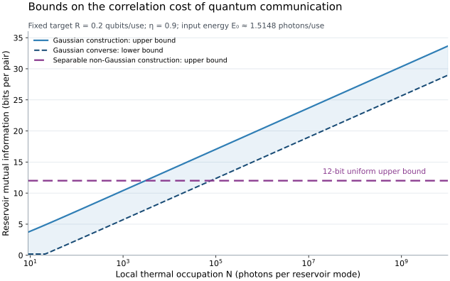

# Verification

The analytical proofs establish the uniform rate and correlation-cost laws. The computations here check vulnerable identities through independent representations and provide reproducible evaluations of the explicit bounds.

## Run the checks

From the repository root:

```bash
python3 -m pip install -r verification/requirements.txt
python3 verification/verify_science.py
python3 verification/plot_bounds.py
```

The first script writes [results.json](results.json). The second writes [the bound data](correlation_cost_bounds.csv) and [the correlation-cost figure](correlation_cost_bounds.svg). It also generates a PNG preview for visual inspection.

No random sampling is used. NumPy and SciPy implement the quadratures; Matplotlib is needed only for the figure. The recorded result includes the observed numerical-library versions.

## Checks and observed values

| Check | Independent numerical route | Observed maximum discrepancy |
|---|---|---:|
| Normalization and input energy | Integrate the two physical wavefunctions and their weak derivatives | $`4.5\times10^{-16}`$ across the quadratic forms |
| Modular decoder | Integrate displaced oscillator matrix units over the discarded gauge coordinates | $`6.9\times10^{-12}`$ |
| Trace preservation | Trace each recovered matrix unit | $`7.6\times10^{-15}`$ |
| Complete positivity | Diagonalize each numerically recovered Choi state | Smallest eigenvalue $`-6.5\times10^{-17}`$, within roundoff |
| Decoded Pauli probabilities | Average four physical signed displacements and compare the Choi spectrum | $`5.6\times10^{-17}`$ |
| Retention-function Fourier coefficients | Integrate 17 trigonometric coefficients directly | $`1.9\times10^{-16}`$ |
| Thermal residue-cell probabilities | Compare normal-CDF sums with wrapped-density quadrature | $`4.2\times10^{-15}`$ |

The direct decoder check covers 20 displacement pairs and all four logical matrix units, including displacements with lattice indices up to 100. It includes positive and negative shifts, points on both sides of bin boundaries, and simultaneous large shifts in both quadratures. This checks that the crossing pieces are traced in the correct gauge cells. It does not assume that the physical wavepackets themselves are translation invariant.

The energy check uses the quadratic form of the oscillator number operator. In particular, it integrates $`|\psi'(q)|^2`$ for the momentum contribution. This handles the packet's derivative discontinuities correctly and verifies that every logical input has the same mean photon number.

## Explicit operating point

The formulas at $`\eta=0.9`$ and $`M=64`$ give

```math
E_0=\frac{2\pi}{3}-\frac{1}{4\pi}-\frac12
   =1.5148176308\ldots,
\qquad I(E_1:E_2)\le12.
```

Evaluating the analytic lower-bound parameters gives

```math
A_{\mathrm{low}}\simeq0.9432579593970494,
\qquad
c_{\mathrm{low}}\simeq0.8358050981118189,
```

and a coherent-information bound of approximately $`0.24259452381737`$ qubits per use. The safely rounded displayed guarantee is **more than $`0.24259`$ qubits per use**. The decimals evaluate an analytical expression; a floating-point evaluation alone is not the proof of the inequality.

For the matching Gaussian bath, the same finite-energy encoder, amplifier, and modular decoder are used with zero residue error. Replacing $`\cos(2\pi/64)`$ by one in the analytical bound improves both parameters, so this code supports at least the same rate with the same energy for every logical input. The script evaluates this finite-dimensional coding bound explicitly.

The thermal-input pure-loss coherent information $`g(\eta E_0)-g((1-\eta)E_0)\simeq1.6761131207`$ is recorded only as an auxiliary Gaussian entropy benchmark. The Gaussian feasibility proof uses the fixed-energy inner code above.

## Finite-temperature diagnostics

The script also evaluates the actual finite-cell construction at

```math
N\in\{10^{-3},10^{-1},1,9,10^2,10^4,10^8\}.
```

Each real coherent amplitude has variance $`N/2`$. Its wrapped-normal density is integrated within the residue cells. Spatial Gaussian images are used for narrow distributions and Poisson summation for broad distributions. The cell masses are independently checked using normal CDFs. Quadrature orders 48 and 96 agree to better than $`1.5\times10^{-14}`$ over these examples.

If $`F_{j,k}`$ is the unnormalized $`k`$th characteristic integral in cell $`j`$ and $`p_j`$ is its mass, then the residue difference has characteristic value

```math
\phi_k=\sum_j\frac{|F_{j,k}|^2}{p_j}.
```

This evaluates the conditional-independent sampling rule directly. The numerical values of $`A`$, $`c`$, and the decoded coherent information exceed their analytic uniform lower bounds at every sampled temperature. The shared-label entropy approaches 12 bits; it is an upper bound on the bath's quantum mutual information, which this script does not compute.

The Fourier evaluation retains odd frequencies through 15. At the operating point, the omitted contribution to $`A`$ has absolute value at most

```math
\left(\frac{16}{3\pi^2}-\frac12\right)
e^{-17^2\pi(1-\eta)/(2\eta)}
<5.1\times10^{-24}.
```

Quadrature convergence and floating-point checks are numerical diagnostics, not interval-arithmetic certificates. The exact marginal identities, mutual-information bound, positive capacity for every $`N`$, and asymptotic separation follow from the written arguments.

## How to read the figure



The figure fixes $`\eta=0.9`$, signal budget $`E_0`$, and target rate $`R=0.2`$. Its Gaussian lower and upper curves are

```math
\max\{R,\,2g(N)-g(2N)-g(9)\},
\qquad
2g(N)-g(2N),
```

where $`g(x)=(x+1)\log_2(x+1)-x\log_2x`$. The horizontal line is the 12-bit upper bound from the separable non-Gaussian construction. The shaded band brackets the Gaussian cost using a necessary lower bound and a feasible upper bound. None of the curves is an evaluation of an optimized correlation cost.

The plotting code evaluates $`g`$ as $`\log_2(1+x)+x\log_2(1+1/x)`$ to avoid subtracting large nearly equal terms at high occupation.

## Perturbation bounds

The robustness checks evaluate the specific bounds in [the robustness account](../science/robustness.md). A biased, correlated three-point displacement law is integrated at the wavefunction level to verify the general Choi spectrum involving the absolute coherence $`|B|`$. The script then checks the stated lower rates for root-mean-square displacement errors $`d=0.01`$ and $`d=0.02`$, independent Gaussian variance $`\Delta=0.05`$, and the combined calibration example $`d_N\le0.01`$, $`t_{\rm vac}\le0.005`$. It does not numerically certify an adversarial perturbation class or a necessary calibration precision; those statements retain the exact scope proved in the scientific account.

## Check the hosted mathematics

The [Hosted mathematics workflow](../.github/workflows/hosted-math.yml) reads the exact pull-request head and checks every tracked Markdown page on GitHub. It uses an anonymous browser at widths of 1440 and 760 pixels, compares each rendered MathML expression with the pinned source, and checks the headline inequalities against [an explicit text contract](hosted/math-contract.json). The workflow has read-only repository permissions and retains its HTML, screenshots, source inventory, and comparison reports as downloadable run artifacts for 14 days.

The [collector](hosted/capture_hosted_math.cjs) and [comparison helper](hosted/check_rendered_math.py) can also run locally with Node.js 18 or newer, Python 3.10 or newer, Git, and the dependencies in [the locked package manifest](hosted/package-lock.json). Install those dependencies in a separate temporary directory, install Playwright's Chromium, and pass the full source commit to the collector:

```bash
NODE_PATH=/absolute/dependencies/node_modules node verification/hosted/capture_hosted_math.cjs \
  --root /absolute/repository \
  --repository GoGoKo699/Quantum-Thermal-Correlation-Cost \
  --revision FULL_40_CHARACTER_COMMIT \
  --output /absolute/new-empty-evidence-directory \
  --contract verification/hosted/math-contract.json
```

The generated `hosted-report.json` binds the comparisons to the commit, file hashes, page scope, and browser widths. A structural pass still requires visual inspection of the saved equations, tables, figures, and navigation. It checks the observed hosted presentation; it does not establish scientific correctness or guarantee future GitHub rendering.
